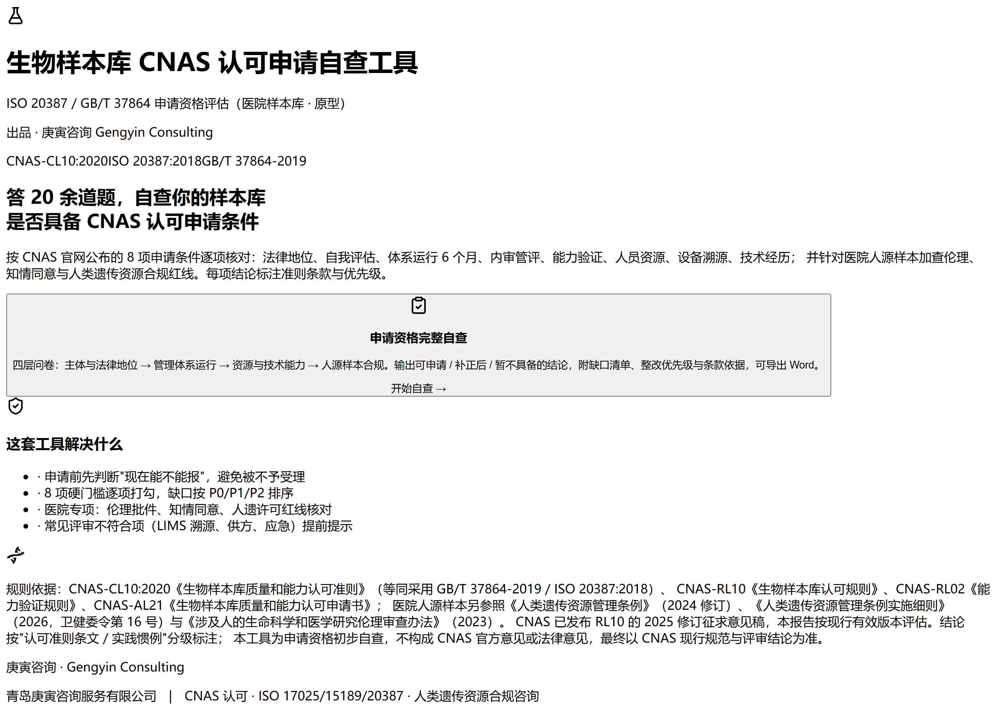
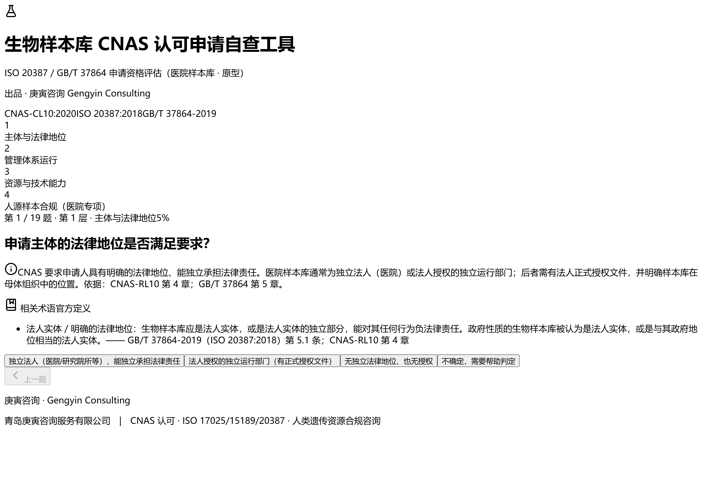
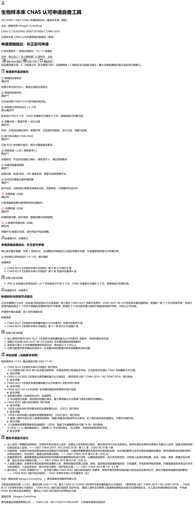

# 生物样本库 CNAS 认可（ISO 20387）申请评估工具

> 出品 / 维护：**庚寅咨询 · Gengyin Consulting** — 青岛庚寅咨询服务有限公司（CNAS 认可 · ISO 17025/15189/20387 · GB/T 37864 · 人类遗传资源合规咨询）

本工具是生物样本库 CNAS 认可申请前的**自查评估原型**。回答 21 道分层问题（非人源样本减为 19 题），即输出三档结论——**可申请 / 补正后可申请 / 暂不具备**，并给出 8 项硬门槛逐项判定、P0/P1/P2 整改优先级、条款引用与置信度分级，可导出 Word 报告。

> ⚠️ **免责声明**：本工具为产品原型，所有输出均为基于公开认可规范与法规的自动化初步评估，**不构成认证结论或法律意见**。正式申请请以 CNAS 最新发布文件及评审组现场判定为准。

## 界面预览

| 入口首页 | 评估向导 |
|---|---|
|  |  |

| 评估报告：三档结论 + 硬门槛判定 + 整改优先级 |
|---|
|  |

## 为什么做这个工具

CNAS 生物样本库认可（依据 CNAS-CL10:2020 / GB/T 37864-2019 / ISO 20387:2018）的申请门槛，往往卡在几件"看起来有、实际上不成立"的事情上：法人主体能否独立承担法律责任、体系是否完成完整的内审与管理评审、样本保藏的授权链条是否闭环、人源样本是否同时满足人类遗传资源许可要求。

本工具把这些前置判断拆成四层问题，让申请人在投入体系建设和咨询费用之前，先知道自己站在哪一档。

## 评估结构

| 层级 | 内容 | 主要依据 |
|---|---|---|
| 1. 主体与法律地位 | 法人资格、固定场所、组织架构、授权链条 | CNAS-RL10、CNAS-CL10:2020 |
| 2. 体系运行 | 管理体系文件、内审 8.8、管理评审 8.9、运行记录 | ISO 20387:2018、GB/T 37864-2019 |
| 3. 资源能力 | 人员、设施设备、样本处置与环境控制、信息系统 | CNAS-CL10:2020 |
| 4. 人源合规红线 | 人遗保藏许可 / 备案、知情同意、伦理审查、对外提供 | 人类遗传资源管理条例及 16 号令实施细则 |

## 结论与整改

- **可申请**：8 项硬门槛全部满足，可直接进入申请准备。
- **补正后可申请**：主体与体系基本具备，存在 P1/P2 级缺口，按清单补正后申请。
- **暂不具备**：存在 P0 级硬缺口（如无法人资格、未完成内审管评、人源样本无合法来源），建议先完成整改。

每条整改项均标注优先级与对应条款，便于直接转化为内部整改台账。

## 依据清单

详见 [`docs/依据清单-CNAS生物样本库认可.md`](docs/依据清单-CNAS生物样本库认可.md)。该清单核实了 CNAS 官网申请条件、内审 8.8 / 管评 8.9 要求，并说明 CNAS-RL10 征求意见稿不作为现行判定依据。

## 本地运行

```bash
npm install
npm run test:rules   # 规则自检（12 项）
npm run build
npm run dev
```

## 目录结构

```
src/
  rules/          # 规则层：题目、判定、法规引用、术语表、类型
  components/     # 向导、结果页、通用 UI
  pages/          # 首页
  utils/          # Word 导出
docs/
  依据清单-CNAS生物样本库认可.md
  skill/                      # 中文「生物样本库 CNAS 认可」Agent Skill（可安装的知识包）
    README.md
    biobank-cnas-accreditation/
      SKILL.md
      references/             # 9 份依据与流程
      scripts/                # 确定性资格快判脚本
      assets/                 # 6 份可交客户模板
smoke-test.mts    # 规则引擎冒烟测试
```

## 配套：中文咨询知识包（Agent Skill）

除在线工具外，本仓库同时开源一份**中国口径**的 Agent Skill，可直接安装到 WorkBuddy / Claude Code 使用。它把 8 项申请条件、22 题自查题库、三档资格判定、7 阶段咨询 SOP、法规依据、人源合规红线、6 份可交客户模板与一个确定性判定脚本固化为可复用知识包。

与 GitHub 上依据 ISBER / CAP / GDPR 的英文同类 Skill 不同，本技能以 CNAS-CL10:2020 / GB/T 37864-2019、RL10 / RL02 / AL21 及 2026 年卫健委令第 16 号为准，并纠正了 CL06、内审 4.7 / 管评 4.8 等网络误标。

详见 [`docs/skill/README.md`](docs/skill/README.md)（安装方式、目录结构、脚本用法、维护约定）。

---

**庚寅咨询 · Gengyin Consulting** ｜ CNAS 认可 · ISO 17025/15189/20387 · 人类遗传资源合规咨询
